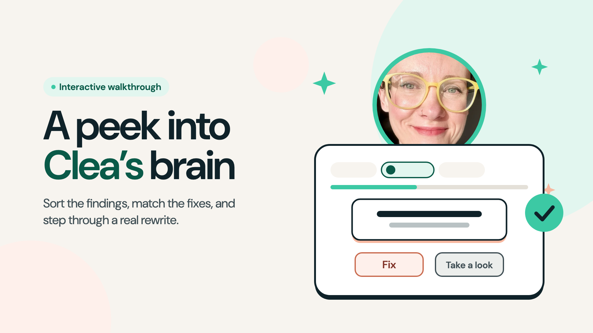

# CLEA skills: Customer Learning Experience Agents

AI skills for customer education (mostly) and job search, by Clea Mahoney. Each skill does one job and leaves the judgment calls to a person. Adapt them to your own company, audience, and tools.

Some skills were built and used on a real customer education team, then rewritten for sharing. No company, customer, or employee data is included.

**[Click through the webinar walkthrough](https://clea-mahoney.github.io/clea-skills/)** to see how lesson-eval and course-dev changed over time, or **[try the interactive version](https://clea-mahoney.github.io/clea-skills/walkthrough/)** to sort the findings and match the fixes yourself.

## The skills

| Skill | What it does | Where a person decides | Download |
|---|---|---|---|
| [course-dev](skills/course-dev/SKILL.md) | Drafts lessons from an approved outline, runs lesson-eval, builds the course in your LMS through its MCP connector, and checks the LMS against the drafts | Approving each draft, choosing the reviewer, and when the course goes live | [Download](https://github.com/clea-mahoney/clea-skills/raw/main/downloads/course-dev.zip) |
| [lesson-eval](skills/lesson-eval/SKILL.md) | Checks a lesson draft in one pass and lists only what needs fixing: a clear point, specific media placeholders, a forward-pointing ending, and writing that sounds like a person | Only Fix items block. Take a look items are your call. | [Download](https://github.com/clea-mahoney/clea-skills/raw/main/downloads/lesson-eval.zip) |
| [job-me](skills/job-me/SKILL.md) | Checks public company job boards for roles that fit your search, keeps one list with a status per role, and builds a filterable board. Set up for L&D, training, instructional design, and customer education titles. Your matches stay on your machine. | Which roles to apply to and which to skip | [Download](https://github.com/clea-mahoney/clea-skills/raw/main/downloads/job-me.zip) |

## Add a skill to Claude

1. Click **Download** in the table above. You get a compressed folder (a `.zip` file). Don't unzip it.
2. In Claude, open **Settings → Capabilities → Skills** and upload that file.
3. Open the skill's `SKILL.md` and follow its setup instructions before you use it.
4. Swap in your own examples where the skill asks.
5. Try it on real work and watch the first run. Check what it flags against your own judgment, then adjust the instructions.

## Tips

- Give each skill your context: company, learners, and tools.
- Keep skills focused. Hand off between them instead of building one huge prompt.
- When a skill keeps growing, look for where the mistake starts before you add another check.
- Watch the first run yourself before you put a skill on a schedule.

## Where they were shared

Some of the customer education skills were shared in the Skilljar by Gainsight webinar *"Wait, How Did You Get AI to Do That?: AI Workflows for Customer Education"* (October 15, 2026), co-presented with [Christie DeCarolis](https://christiedecarolis.com/aiworkflows.html).

## License

MIT License: you can use, copy, change, and share these skills for free, including at work, as long as you keep the license notice with them. They come as is, with no warranty. Credit is appreciated but not required. See [LICENSE](LICENSE).

Created by Clea Mahoney.
